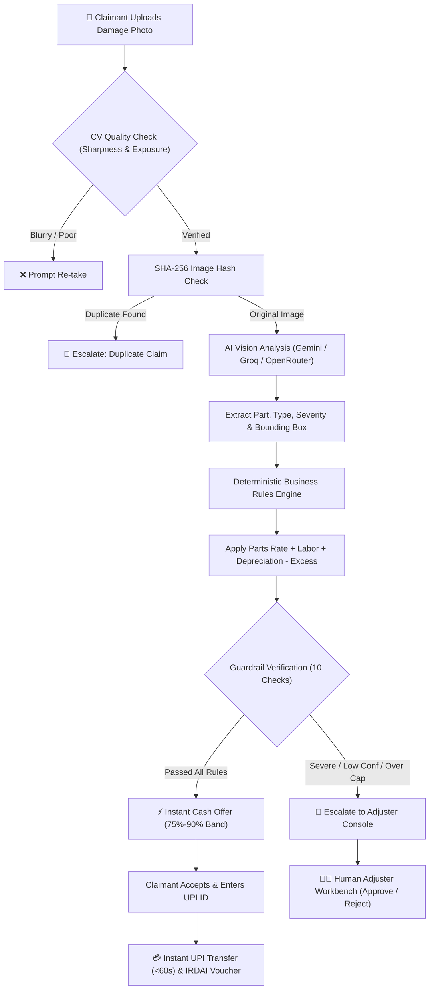

# 🚗 Auto-Settle AI · Touchless Motor Claims Engine
> **Confluentia Applied ML Hackathon — Milestone 2**  
> *End-to-end autonomous First Notice of Loss (FNOL) appraisal, deterministic rule-based pricing, and instant UPI settlement for minor motor insurance claims.*

[](https://auto-settle-ng434.streamlit.app/)
[](https://auto-settle-ng434.streamlit.app/)
[](https://auto-settle-ng434.streamlit.app/)

---

## 📌 Executive Summary

Minor motor insurance claims in India (such as bumper parking scrapes and door dings under ₹25,000) take an average of **14 days to settle**, with insurers spending **₹3,500+ in surveyor inspection fees and paperwork** per incident.

**Auto-Settle AI** completely eliminates workshop friction by providing **sub-60-second touchless straight-through processing (STP)**:
1. **The Claimant** uploads a smartphone photo of the damage $\to$ the AI identifies damaged panels $\to$ deterministic business rules compute an instant cash payout $\to$ money is disbursed directly via **UPI / IMPS** with an official settlement receipt.
2. **The Insurer** saves up to **41% in claims processing overhead** and retains complete control through strict financial guardrails and an **Enterprise Adjuster Workbench**.

---

## 🌟 Key Features & Innovations

### 1. 🤖 Touchless Vision Appraisal & Smart Auto-Detect
- **Smart Auto-Detect by Default:** Claimants do not need to understand automotive body panels. Selecting *"🤖 Unsure · Let AI Auto-Detect"* instructs the computer vision model to locate and segment all damaged components without false mismatch flags.
- **Automated Photo Quality Assurance:** Computer vision pre-check for blur (Laplacian variance) and exposure levels before submitting to the model.
- **Visual Bounding Boxes:** Color-coded severity overlays (Minor = Green, Moderate = Amber, Severe = Red) highlighting damage areas.

### 2. 🛡️ Deterministic Rule Engine (Zero AI Financial Hallucination)
- **The AI Only Describes; Fixed Code Decides:** The LLM vision model never sets monetary amounts.
- **Rule-Based Valuation:** Repair costs are calculated using standard parts tables, hourly labor benchmarks (₹500/hr), vehicle age depreciation curves (5%/year up to 50%), and policy deductibles.
- **Guaranteed Settlement Bands:** Cash offers are bounded strictly between **75% and 90%** of net claim value, configured directly by the insurer.

### 3. 🚨 10 Strict Safety & Anti-Fraud Guardrails
Automatic escalation to human surveyors triggers instantly upon:
- Severe structural damage or shattered safety elements (headlights, windshields).
- AI confidence scoring falling below the minimum threshold ($<70\%$).
- Net repair value exceeding policy caps (₹25,000 auto-settle cap).
- Duplicate photo detection using cryptographic SHA-256 image fingerprinting.
- Lapsed policy or excessive claim frequency ($>3$ claims in 12 months).

### 4. 💳 Fintech-Grade UPI Settlement & IRDAI Receipts
- **Google Pay / PhonePe-Style Animated Payout Card:** Real-time hardware-accelerated SVG checkmark and emerald ambient glow.
- **One-Click Pre-Filled Demo VPA:** Fast, foolproof live judging demo (`rahul.demo@okhdfcbank`).
- **Official Voucher:** Generates an IRDAI-compliant digital claims settlement voucher with unique IMPS transaction IDs.

### 5. 📊 Before vs. After Savings Analytics
- Interactive comparative visualization contrasting the **traditional 14-day workshop route (₹8,295)** against the **instant Auto-Settle cash route (₹4,859)**, demonstrating direct savings of **₹3,436 (41%)** for the insurer and zero downtime for the car owner.

### 6. 🔍 Enterprise Adjuster Console (Dual-Portal Experience)
- **Executive KPI Strip:** Live metrics for total claims, straight-through rate (STP %), average turnaround time (<60s), and cumulative insurer savings.
- **Status Filter Pills:** Segmented queue view for *All*, *Needs Review*, *Open*, and *Settled*.
- **Side-by-Side Review Workbench:** Split-screen interface showing the damaged photo with annotated bounding boxes on the left, escalation flags on the right, and one-click *Approve Payout* / *Reject Claim* overrides.

### 7. 🌐 India-First Bilingual Interface
- Instant navbar segmented pill toggle switching seamlessly between **English** and **हिंदी** across all claims, buttons, and receipts.

### 8. 🛡️ 100% Offline Demo Safety Net
- Pre-bundled with 3 authentic vehicle damage photo cases (`demo_bumper_scrape.jpg`, `demo_door_dent.jpg`, `demo_severe_crash.jpg`) that execute end-to-end in **1 click with zero dependency on external APIs or venue Wi-Fi**.

---

## 🏗️ Architecture & Pipeline Flow



---

## ⚡ 60-Second Quickstart for Judges

You can test the full pipeline directly on the **[Live Deployed App](https://auto-settle-ng434.streamlit.app/)**:

1. **Test STP Instant Payout:**
   - In the **New Claim** tab, open `⚡ Pre-filled sample cases`.
   - Click **Run Demo** on **Case 1: Bumper Corner Scrape**.
   - Review the damage bounding box, the cost breakdown, and the savings comparison.
   - Click **⚡ Accept ₹4,859 & Disburse Now** $\to$ see the PhonePe-style animated payout card $\to$ click **Download Receipt**.
2. **Test Safety Guardrails & Underwriter Escalation:**
   - Click **🔄 Run Next Claim Demo**.
   - Click **Run Demo** on **Case 3: Severe Front Collision**.
   - Observe how the AI flags structural fracture, freezes straight-through payout, and routes the claim for surveyor inspection.
3. **Test the Enterprise Adjuster Workbench:**
   - Switch on the **Admin mode** toggle in the top navbar.
   - Click the **Adjuster dashboard** tab to inspect the live KPI strip and review the side-by-side inspection workbench.

---

## 💻 Local Development Setup

```bash
# 1. Clone the repository
git clone https://github.com/namang34/Auto-Settle-AI.git
cd Auto-Settle-AI

# 2. Install dependencies
pip install -r requirements.txt

# 3. Configure API keys (Optional - app runs offline demos without any keys)
# Copy secrets.toml.example to .streamlit/secrets.toml and add keys:
# GEMINI_API_KEY = "..."
# GROQ_API_KEY = "..."

# 4. Launch the application
streamlit run app.py
```

### Running Automated Test Suite
The deterministic valuation and safety guardrails are covered by pytest:
```bash
pytest test_core.py -v
```

---

## 👥 Confluentia Applied ML Hackathon — Team
* **Track:** Applied Machine Learning
* **Milestone:** Milestone 2
* **Repository:** [github.com/namang34/Auto-Settle-AI](https://github.com/namang34/Auto-Settle-AI)
* **Live Deployment:** [auto-settle-ng434.streamlit.app](https://auto-settle-ng434.streamlit.app/)
